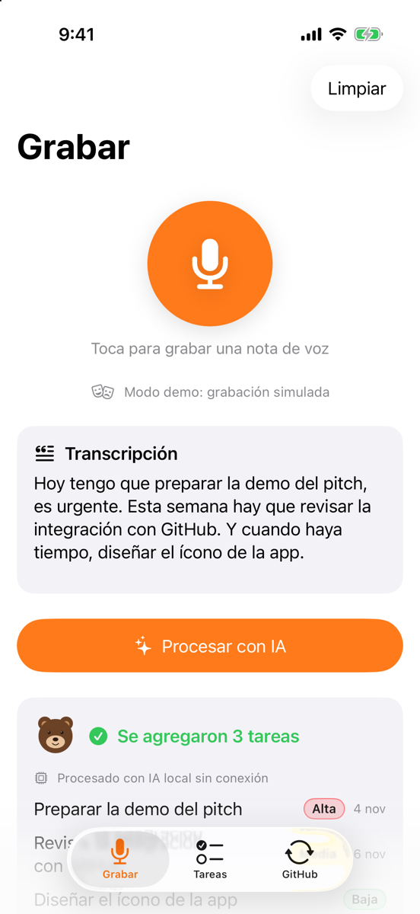
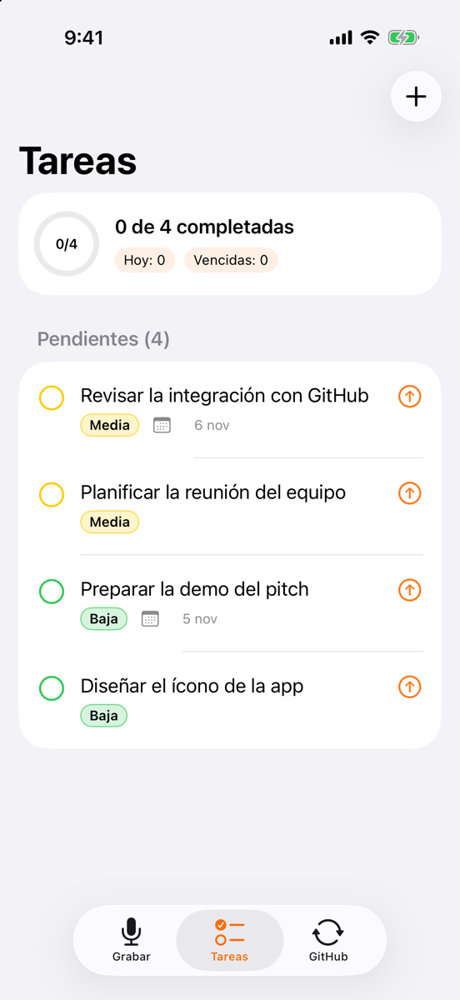
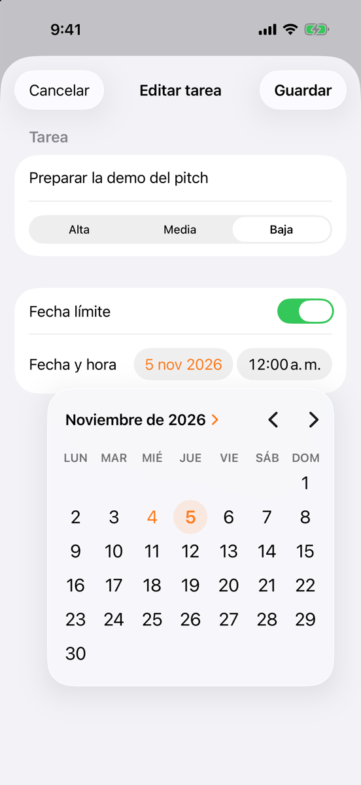
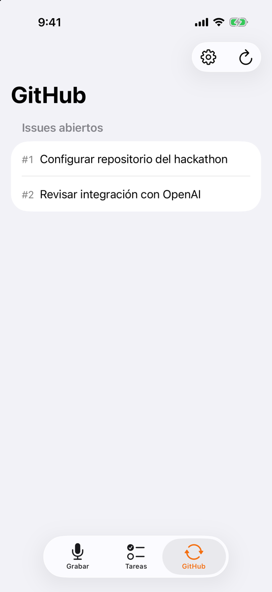

# Voice2Task

**Convierte lo que dices en tareas accionables, con fechas y prioridades, sin necesitar una API key.**

## Por qué

Las tareas suelen aparecer mientras hablamos, no cuando estamos frente a una lista. Voice2Task transforma una nota hablada o escrita en tareas que puedes revisar y completar.
El procesamiento puede quedarse en el dispositivo, y cada tarea puede llevar un recordatorio o convertirse en un issue de GitHub.

## Funciones

- Dictado en vivo y entrada manual de texto.
- Extracción en tres niveles: OpenAI → Apple Intelligence → IA local sin conexión.
- Reconocimiento de fechas y prioridades en español.
- Crear y editar tareas, añadir fechas límite y recibir recordatorios.
- Atajo de Siri: **«Crear tareas con Voice2Task»**.
- Crear issues de GitHub sin duplicados.
- Modo demo para probar la grabación y la integración con GitHub sin credenciales.

## Arquitectura

La app está organizada en `Models`, `Services`, `ViewModels`, `Views` e `Intents`. Usa SwiftUI, SwiftData para persistir tareas y `@Observable` para conectar los modelos de vista con la interfaz. Los archivos Swift bajo `Voice2Task/` se incorporan al target mediante grupos sincronizados de Xcode.

## Requisitos y ejecución

- Xcode 16 o posterior.
- iOS 17 o posterior.
- Apple Intelligence requiere iOS 26 y un dispositivo compatible. La extracción local sin conexión sigue disponible en dispositivos anteriores.

Abre `Voice2Task.xcodeproj` en Xcode y ejecuta el esquema `Voice2Task` en un simulador o dispositivo. Para compilar desde Terminal:

```sh
xcodebuild -project Voice2Task.xcodeproj -scheme Voice2Task \
  -destination 'generic/platform=iOS Simulator' \
  -configuration Debug build
```

## Configuración

Configura los valores desde la hoja **Ajustes** de la pestaña GitHub o antes de iniciar la app mediante estas variables de entorno:

| Variable | Uso |
| --- | --- |
| `OPENAI_API_KEY` | API key opcional para la extracción con OpenAI. |
| `GITHUB_OWNER` | Usuario u organización propietaria del repositorio. |
| `GITHUB_REPO` | Repositorio donde crear y consultar issues. |
| `GITHUB_TOKEN` | Token de GitHub; necesario para crear issues y opcional para consultar repositorios públicos. |

Sin API key de OpenAI, Voice2Task intenta Apple Intelligence y después usa su extractor local. El token de GitHub solo se usa para la integración con GitHub.

## Modo demo

Activa **Modo demo (datos de prueba)** en **Ajustes**, o elige **Probar con datos de demo** durante la bienvenida. La grabación simula una nota hablada y GitHub muestra datos de prueba; no hace falta configurar una cuenta para explorar la interfaz.

## Probar en Appetize

Compila la app para el simulador, comprime el bundle `.app` y súbelo a [Appetize](https://appetize.io/):

```sh
xcodebuild -project Voice2Task.xcodeproj -scheme Voice2Task \
  -destination 'generic/platform=iOS Simulator' \
  -configuration Debug -derivedDataPath build/DD build CODE_SIGNING_ALLOWED=NO
ditto -c -k --sequesterRsrc --keepParent \
  build/DD/Build/Products/Debug-iphonesimulator/Voice2Task.app \
  build/Voice2Task.zip
```

Crea una vista previa de iOS en Appetize, carga `build/Voice2Task.zip` y activa el modo demo en la app para probar el flujo sin credenciales.

## Capturas

| Grabar en modo demo | Tareas y progreso |
| --- | --- |
|  |  |

| Editar una tarea | Issues de GitHub en modo demo |
| --- | --- |
|  |  |
