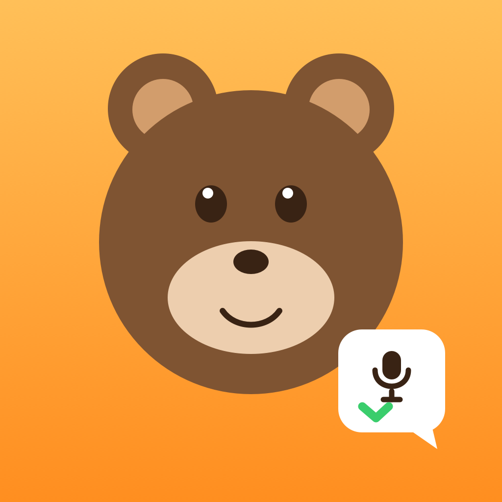

<p align="center">
  
</p>

<h1 align="center">Voice2Task</h1>

<p align="center"><b>Habla. El oso escucha. Tus pendientes se convierten en tareas.</b><br>
App iOS nativa que convierte una nota de voz en tareas con prioridad, fecha límite y recordatorio, y las sube como issues de GitHub. Funciona sin conexión y sin API keys.</p>

## Descripción

Las ideas y los pendientes aparecen en medio de una conversación, una reunión o un pasillo, no cuando tienes una lista abierta. Apuntarlos a mano cuesta tiempo y muchos se pierden.

Con **Voice2Task** dictas todo lo que tienes pendiente, como se lo contarías a un compañero: *"Mañana llamar al cliente, es urgente. El viernes enviar el reporte. Y cuando haya tiempo, diseñar el ícono."*. La app transcribe en vivo, separa cada tarea, detecta su prioridad y su fecha y las guarda en una lista con progreso y recordatorios. Con un toque, cada tarea se convierte en un issue de GitHub para que el equipo la vea.

La extracción de tareas tiene tres niveles: usa OpenAI si hay API key; si no, Apple Intelligence en el dispositivo (iOS 26); y si tampoco está disponible, un extractor local en español que funciona sin conexión. Así la app siempre sirve, incluso en una demo sin internet.

## Cómo funciona

1. **Graba:** toca el micrófono y habla. El oso te escucha con una onda de audio en vivo y `SFSpeechRecognizer` transcribe en español.
2. **Procesa:** "Procesar con IA" divide la nota en tareas y detecta prioridades (*urgente*, *cuando haya tiempo*) y fechas (*hoy*, *mañana*, *el viernes*, *esta semana*).
3. **Organiza:** edita, completa o crea tareas a mano. Un anillo de progreso muestra lo pendiente para hoy y lo vencido, y al terminar todo aparece "¡Todo listo!".
4. **Comparte:** sube cada tarea como issue de GitHub. Si una tarea ya tiene issue, se vincula al existente y no se duplica.
5. **Sin abrir la app:** con Siri o Atajos, di «Crear tareas con Voice2Task».

## Funciones

- Dictado en vivo y entrada manual de texto.
- Extracción en tres niveles: OpenAI → Apple Intelligence → IA local sin conexión.
- Reconocimiento de fechas y prioridades en español.
- Crear y editar tareas, añadir fechas límite y recibir recordatorios por notificación.
- Atajo de Siri: **«Crear tareas con Voice2Task»**.
- Crear issues de GitHub sin duplicados.
- Pantalla de bienvenida, modo oscuro, vibración y animaciones con la mascota.
- Modo demo para probar la grabación y la integración con GitHub sin credenciales.

## Tecnologías

Swift, SwiftUI, SwiftData, Observation (`@Observable`), Speech + AVFoundation, FoundationModels (Apple Intelligence), App Intents, UserNotifications, OpenAI Chat Completions (`gpt-4o-mini`) y la API REST de GitHub. Requiere iOS 17 o posterior y no usa dependencias de terceros.

El proyecto se desarrolló con [Devin](https://devin.ai), que escribió el código, lo compiló y lo probó en el simulador de iOS, y generó el build para Appetize.

## Arquitectura

La app está organizada en `Models`, `Services`, `ViewModels`, `Views` e `Intents`. Usa SwiftUI, SwiftData para persistir tareas y `@Observable` para conectar los modelos de vista con la interfaz. Los archivos Swift bajo `Voice2Task/` se incorporan al target mediante grupos sincronizados de Xcode.

## Requisitos y ejecución

- Xcode 16 o posterior.
- iOS 17 o posterior.
- Apple Intelligence requiere iOS 26 y un dispositivo compatible. La extracción local sin conexión sigue disponible en dispositivos anteriores.

Abre `Voice2Task.xcodeproj` en Xcode y ejecuta el esquema `Voice2Task` en un simulador o dispositivo. Para compilar desde Terminal:

```sh
xcodebuild -project Voice2Task.xcodeproj -scheme Voice2Task \
  -destination 'generic/platform=iOS Simulator' \
  -configuration Debug build
```

## Configuración

Configura los valores desde la hoja **Ajustes** de la pestaña GitHub o antes de iniciar la app mediante estas variables de entorno:

| Variable | Uso |
| --- | --- |
| `OPENAI_API_KEY` | API key opcional para la extracción con OpenAI. |
| `GITHUB_OWNER` | Usuario u organización propietaria del repositorio. |
| `GITHUB_REPO` | Repositorio donde crear y consultar issues. |
| `GITHUB_TOKEN` | Token de GitHub; necesario para crear issues y opcional para consultar repositorios públicos. |

Sin API key de OpenAI, Voice2Task intenta Apple Intelligence y después usa su extractor local. El token de GitHub solo se usa para la integración con GitHub.

## Modo demo

Activa **Modo demo (datos de prueba)** en **Ajustes**, o elige **Probar con datos de demo** durante la bienvenida. La grabación simula una nota hablada y GitHub muestra datos de prueba; no hace falta configurar una cuenta para explorar la interfaz.

## Probar en Appetize

No necesitas Mac ni iPhone: compila un bundle universal para el simulador (arm64 + x86_64), comprímelo y súbelo a [Appetize](https://appetize.io/):

```sh
xcodebuild -project Voice2Task.xcodeproj -scheme Voice2Task -sdk iphonesimulator \
  -configuration Release ARCHS="arm64 x86_64" ONLY_ACTIVE_ARCH=NO \
  CODE_SIGNING_ALLOWED=NO -derivedDataPath build/appetize build
cd build/appetize/Build/Products/Release-iphonesimulator
zip -r Voice2Task-simulator.zip Voice2Task.app
```

Crea una app iOS en Appetize, sube `Voice2Task-simulator.zip` y elige **Probar con datos de demo** en la bienvenida para recorrer el flujo sin credenciales. Es mejor pegar el texto que escribirlo, porque el autocorrector del simulador puede cambiar palabras en español.

## Capturas

| Grabar en modo demo | Tareas y progreso |
| --- | --- |
|  |  |

| Editar una tarea | Issues de GitHub en modo demo |
| --- | --- |
|  |  |
